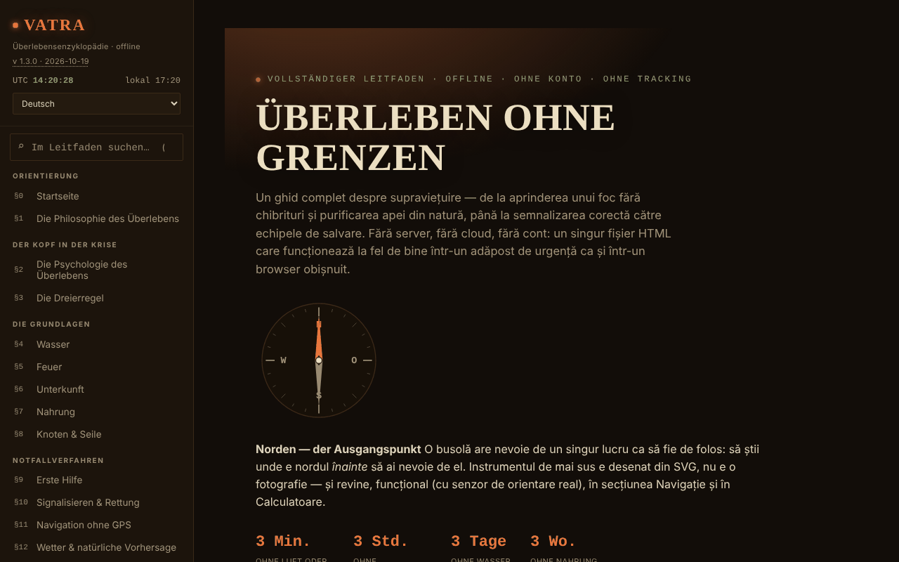

# VATRA — Die Enzyklopädie des Überlebens

[English](README.md) · [Română](README.ro.md) · [Français](README.fr.md) · [Italiano](README.it.md) · [Español](README.es.md) · [Português](README.pt.md) · **Deutsch** · [Magyar](README.hu.md)

**Version:** 2.2.0 · **Zuletzt aktualisiert:** 2026-10-27

**Status:** stabil · **Offline:** vollständig

Oberflächensprachen: **Română, English, Français, Italiano, Español, Português (PT), Deutsch, Magyar**

**Online-App / Demo:** https://chiuta.github.io/VATRA/

Überlebensratgeber in einer einzigen HTML-Datei (`index.html`), in 8 Sprachen: ~21 Abschnitte (Wasser, Feuer, Unterkunft, Nahrung, Knoten, Erste Hilfe, Signalisieren, Navigation ohne GPS, Wetter, Lebensräume, Katastrophen, gefährliche Tiere, Ressourcen für Rumänien), interaktives Notfallset, Rechner (Wasser, Kalorien, Unterkühlung/Überhitzung, Azimut), Kompass, Glossar und Wissenstest.

**Sprachen:** alle Abschnitte des Leitfadens, das Glossar und das Wissensquiz liegen in den 8 Sprachen vor; offizielle Eigennamen (Salvamont, RO-ALERT usw.), Morsezeichen, Zahlen/Codes und lateinische wissenschaftliche Namen bleiben unverändert. Die Übersetzungen sind automatisch und nicht von Muttersprachlern geprüft; **die Erste-Hilfe-Inhalte (Herz-Lungen-Wiederbelebung, Blutung/Abbinden, Unterkühlung, Überhitzung, Verbrennungen, Schlangen-/Zeckenbisse, Schock), die Dosen zur Wasserreinigung (Jod, Chlor, SODIS), essbare Pflanzen/Pilze und der Essbarkeitstest sowie die rumänischen Rechtsvorschriften und Notrufnummern (112, SMS 113, Salvamont, RO-ALERT) müssen fachlich geprüft werden**; es sind getreue Übersetzungen ohne zusätzliche Ratschläge. Die laufende Quizfrage wird nach einem Sprachwechsel erst bei der nächsten Frage aktualisiert.

**Allgemeiner Bildungsinhalt; er ersetzt weder einen zertifizierten Erste-Hilfe- oder Überlebenskurs noch die örtlichen Rettungskräfte oder eine fachärztliche Beurteilung.** Im Notfall in Rumänien die 112 anrufen. Die Angaben im Ratgeber (einschließlich Zahlen, Kontaktnummern, Angaben zu Tieren oder zur Gesetzgebung) können veralten; prüfe die offiziellen Quellen. Die Rechner sind Richtwerte.

## Verwendung
Durchsuche den gesamten Ratgeber über das Feld in der Seitenleiste (Kürzel `/`).
Öffne `index.html` in einem Browser (oder die über GitHub Pages veröffentlichte Version); sie funktioniert offline. Thema „Nacht“/„Tag“ in der Seitenleiste (die Wahl wird gespeichert). Die Häkchen des Sets, deine eigenen Notizen, der Testfortschritt und das Thema werden automatisch lokal im Browser gespeichert (`localStorage`, Schlüssel `vatra:v1`); du kannst sie in der Seitenleiste löschen („Im Browser gespeicherte Daten löschen“) oder als Datei exportieren/importieren.

## Neue Funktionen (v1.1.0, 14. Oktober 2026)

Keine neuen Lernfunktionen in dieser Version: **Die verteilte Wiederholung gibt es bereits** (§19 Wissenstest, „Modus: Verteilte Wiederholung“, mit Export/Import des Fortschritts) und wurde nicht doppelt angelegt. Die einzige Ergänzung ist das folgende Kit.

### Transparenz und Sicherung (fff-kit)

Ein Klick (oder Enter) auf die angezeigte Version (`v 1.1.0 · 2026-10-14`) öffnet das Fenster „Transparenz“: die deklarierten Netzwerk-Hosts (0 externe Anfragen), die lokalen Speicherschlüssel mit Größen, die verwendeten APIs, Größe und SHA-256 der Datei (mit einem Prüfer für eine heruntergeladene Datei) und die **Sicherung** der App-Daten in eine `.fff.json`-Datei (optional mit Passwort verschlüsselt, AES-GCM 256 / PBKDF2; das Passwort kann nicht wiederhergestellt werden), Import mit Bestätigung und Löschen der App-Daten. Das Kit (`fff-kit`, Module: core, label, bundle) ist in `index.html` eingebettet, stellt keine Netzwerkanfragen und ändert keine vorhandenen Daten; ohne es funktioniert die App genauso. Die Sicherung des Kits umfasst den optionalen Speicherschlüssel der App (wenn du das Speichern auf dem Gerät aktiviert hast), nicht den Testfortschritt, der über „Fortschritt exportieren“ exportiert wird. Die Texte des Kits liegen in 8 Sprachen vor (ro, en, fr, it, es, pt, hu, de); **die Übersetzungen fr/it/es/pt/hu/de sind automatisch erstellt und nicht von Muttersprachlern geprüft**. Oberfläche und Inhalt der App liegen ebenfalls in den 8 Sprachen vor (siehe den Sprachhinweis am Anfang); die Inhaltsübersetzungen sind automatisch und nicht von Muttersprachlern geprüft.

## Daten und Datenschutz
Per Audit geprüft: Die Seite stellt keine Netzwerkanfragen (0 Anfragen beim Laden, kein `fetch`/CDN/keine externen Schriften) und sendet nirgendwohin etwas; der einzige Speicher ist der lokale `localStorage` (Schlüssel `vatra:v1`, mit den Häkchen des Sets, den Notizen, dem Testfortschritt und dem Thema), so privat wie die Datei selbst. Die Geolokalisierung (die Schaltfläche im Azimut-Rechner) wird nur auf Anforderung und lokal verwendet. Externe Links (Salvamont, RO-ALERT, Rotes Kreuz usw.) öffnen sich nur beim Klick. Es gilt eine strenge CSP-Richtlinie (Meta): keine Netzwerkverbindungen (`connect-src 'none'`), Skript nur per SHA-256-Hash erlaubt (ohne `unsafe-inline` für Skripte), Inline-Stile.

## Einschränkungen
- Quellen nur teilweise zitiert (ohne ausführliche bibliografische Verweise); die Schätzung der Bärenpopulation hat jetzt eine Quelle (AGERPRES, 10. April 2025); die Gesetzgebung zum Eingreifen bei Bären ändert sich oft (OUG 60/2025 und das nachfolgende Gesetz) und wird nicht artikelweise zitiert: prüfe legislatie.just.ro.
- Der Essbarkeitstest und die Erste-Hilfe-Verfahren sind allgemeine Zusammenfassungen, keine medizinischen Protokolle.

## Lizenz

MIT — siehe Datei `LICENSE`. © 2026 Alexandru-Ionuț Chiuță (Alexio). Gegebenenfalls in der Datei enthaltene Bibliotheken Dritter behalten ihre eigenen Lizenzen.

Der Link „Fehler melden“ (GitHub) verweist jetzt auf `chiuta/vatra`. Die medizinischen Hinweise und Überlebenshinweise (einschließlich des universellen Essbarkeitstests, gekennzeichnet „nur Pflanzen, letzter Ausweg“) bleiben Inhalt des Autors, mit dem Haftungsausschluss auf der Seite und oben.

Audit: 2026-10-10

## Taschenkarte und Installation (v2.1.0)

Die Schaltfläche **Taschenkarte drucken** (Seitenleiste) druckt eine einzelne Taschenkarte (A4, an der gepunkteten Linie auszuschneiden) mit der 3er-Regel, der Reihenfolge der Entscheidungen, den Signalen und dem Ablauf des Notrufs 112 in der gewählten Sprache; der Rest des Leitfadens wird nicht gedruckt. Die Texte stammen aus dem Leitfaden und bleiben daher synchron. **Installation als App (PWA):** Manifest und Service Worker gab es schon; jetzt erscheint die Schaltfläche **Als App installieren**, wenn der Browser sie anbietet, sonst ein Texthinweis (nur von der veröffentlichten https-Seite, nicht von einer lokalen Datei). Ein Inline-Manifest (Blob) wurde nicht verwendet: Es würde eine Lockerung von `manifest-src` erfordern.

## Pocket card with your own details (2.2.0)

_(English only; not yet translated into this language. Machine translation intentionally not added to avoid errors in technical statements.)_

If you filled in the **emergency note** (name, contacts, medical details, route, vehicle) and/or generated the **plan** in the app, the pocket card adds a block "My details (filled in by you in VATRA; not part of the guide)" when printing: the filled fields and the plan summary (environment, season, ticked gear). The block is emptied after printing (`afterprint`); the data stay in the app only, as before, and are sent nowhere. Your text is escaped (not interpreted as HTML). With nothing filled in, the card is identical to 2.1.

**Unchanged and why:** the "inline" (blob) PWA manifest was NOT done: `manifest.webmanifest` and `sw.js` already exist, and an inline manifest would require relaxing `manifest-src` in the CSP. The map and the kit are not on the card. The A4 fit was checked with `print` media emulation, not with a real printer. The new label in fr/it/es/pt/de/hu is a machine translation.

## Verlauf / Changelog

### 2.2.0 — 2026-10-27
- The pocket card optionally includes the user's emergency note and plan summary.

- **2.1.0 — 2026-10-27:** druckbare Taschenkarte (CSS `@media print`) und PWA-Installationsschaltfläche; Zeilen Status/Offline; CHANGELOG.md (vorherige: v2.0.0).

### 1.3.10 — 2026-10-23
- Hitzeindex: folgt jetzt dem vollständigen NWS-Algorithmus (zuerst die einfache Formel, die Rothfusz-Regression erst ab 80 °F, plus die zwei dokumentierten Korrekturen für sehr niedrige und sehr hohe Luftfeuchte); zuvor waren die Werte nahe der 27-°C-Schwelle und bei Feuchte < 13 % oder > 85 % leicht verschoben.
- Persönliche Notizen: höchstens 500 Notizen (Wiederherstellen, Import und manuelles Hinzufügen), damit eine feindliche Datei oder Sicherung die Seite nicht einfrieren oder den Speicher füllen kann.
- Auf Touchscreens (`pointer: coarse`) haben Menü-, Theme- und Sprachsteuerung ein Touch-Ziel von 44 px.

### 1.3.9 — 2026-10-23
- fff-kit 1.2.0: Die Bestätigung „Checkliste zurücksetzen“ verwendet jetzt den gemeinsamen barrierefreien Dialog des Kits (FFF.dialog); die eigene Kopie des Dialogcodes (samt nativem `confirm`-Fallback) wurde entfernt. Verhalten und Übersetzungen unverändert.

### 1.3.7 — 2026-10-22
- fff-kit 1.1.4: Touch-Ziele und Mindestschriftgröße; Touch-Ziele/Text korrigiert

### 1.3.6 — 2026-10-22
- Barrierefreiheit: Das Suchfeld zeigt jetzt einen deutlichen Fokusring (Kontrast von mindestens 3:1) im Nacht- und im Tagdesign.

### 1.3.5 — 2026-10-22
- fff-kit 1.1.2: PBKDF2 mit 600.000 Iterationen, Schutz vor Clickjacking.

### 1.3.4 — 2026-10-22
- Die Bestätigung zum Zurücksetzen der Checkliste ist ein übersetzter modaler Dialog statt des Browser-confirm().
- Barrierefreiheit: Die vier Importfelder (Sicherung, Checkliste, Wiederholungsfortschritt, Notizen) haben Namen, die von Screenreadern angesagt werden.
- Mobil: Der Text ist mindestens 12 px groß, und Schaltflächen und Felder haben auf schmalen Bildschirmen größere Touch-Flächen.

### 1.3.3 — 2026-10-22
- in der rumänischen Oberfläche haben Glossarbegriffe, Knoten und Quiz-Optionen, die englisch geblieben waren (sunk cost, debris hut, clove hitch, rolling hitch, bear spray, lean-to, PLB usw.), jetzt rumänische Bezeichnungen mit dem englischen Begriff in Klammern; „Home“ in der italienischen Navigation lautet jetzt „Inizio“.

### 1.3.2 — 2026-10-22
- Meta-Beschreibung und die Beschreibung im fff-kit-Transparenzpanel folgen jetzt der Oberflächensprache (zuvor nur Rumänisch).

### 1.3.1 — 2026-10-19
- Der gesamte Leitfaden, das Glossar und das Quiz sind nach en, fr, it, es, pt, de, hu übersetzt (die Datei wächst auf etwa 1,5 MB); die Oberfläche ist nicht mehr nur auf Rumänisch. Die medizinischen/Überlebensinhalte müssen fachlich geprüft werden.

### 1.2.0 — 2026-10-19
- Neu: im Rechner „Azimut & Entfernung“ der Link „↗ Der Himmel jetzt, in Bolta“ (Position aus den Feldern, auf ~1 km gerundet; Öffnen in einem neuen Tab; Hinweis zum Verlauf).

### 1.1.0 — 2026-10-14
- fff-kit: das Fenster „Transparenz“ (Klick auf die Version) und die einheitliche `.fff.json`-Sicherung. Inhalt und verteilte Wiederholung blieben unverändert.

### 1.0.4 — 2026-10-12
- Version und Datum der letzten Aktualisierung werden in der App angezeigt (Seitenleiste).

### 1.0.3 — 11. Oktober 2026 (Runde 7)
- Neu: Suche im gesamten Ratgeber (Feld in der Seitenleiste, Kürzel `/`; ohne Beachtung von Diakritika, Ergebnisse mit Ausschnitt und Sprung zur gefundenen Stelle).
- Behoben: In allen Abschnitten außer Startseite hatte die Seite keine Überschrift der Ebene 1 (axe-core `page-has-heading-one`); jetzt wird die Kopfzeile „VATRA“ in der Seitenleiste außerhalb der Startseite zur Überschrift der Ebene 1.

### 1.0.2 — 11. Oktober 2026 (Runde 6)
- Hinzugefügt: automatisches lokales Speichern von Set, Notizen, Testfortschritt und Thema (mit Löschschaltfläche); CSP mit `script-src` per Hash.

### 1.0.1 — 11. Oktober 2026
- Behoben: Der Hero-Titel zeigt während der Animation keine zufälligen Zeichen mehr (Enthüllungseffekt; der endgültige Text steht immer auf der Seite).
- Behoben: Barrierefreiheit: Die mobile Kopfzeile ist ein `<header>`, die Fußzeilen-Überschriften sind h3 (korrekte Reihenfolge); 0 axe-core-Verstöße bei 1280 und 360 px.
- Hinzugefügt: strenge CSP-Richtlinie; Version 1.0.1 in der Seitenleiste angezeigt.
- Aktualisiert: Bärendaten am 11.10.2026 geprüft (Quelle: AGERPRES, 10.04.2025); die Formulierung zur Gesetzgebung behauptet keine ungeprüfte Änderung vom Mai 2026 mehr. Quellen am 11.10.2026 geprüft.

