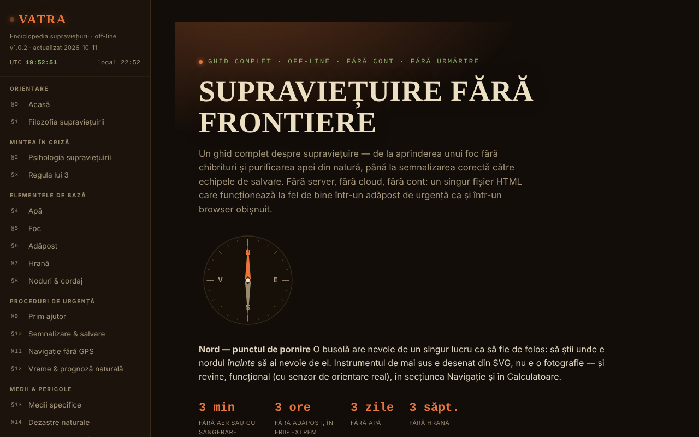

# VATRA — La enciclopedia de la supervivencia

[English](README.md) · [Română](README.ro.md) · [Français](README.fr.md) · [Italiano](README.it.md) · **Español** · [Português](README.pt.md) · [Deutsch](README.de.md) · [Magyar](README.hu.md)

**Versión:** 1.3.0 · **Última actualización:** 2026-10-19

Idiomas de la interfaz: **Română, English, Français, Italiano, Español, Português (PT), Deutsch, Magyar**

**Aplicación en línea / demo:** https://chiuta.github.io/VATRA/

Guía de supervivencia en un único archivo HTML (`index.html`), en rumano: ~21 secciones (agua, fuego, refugio, alimentos, nudos, primeros auxilios, señalización, navegación sin GPS, clima, entornos, desastres, fauna peligrosa, recursos para Rumanía), botiquín de emergencia interactivo, calculadoras (agua, calorías, hipotermia/hipertermia, acimut), brújula, glosario y test de conocimientos.

**Contenido educativo general; no sustituye un curso certificado de primeros auxilios o de supervivencia, al equipo de rescate local ni una evaluación médica especializada.** En una emergencia, en Rumanía, llama al 112. La información de la guía (incluidas cifras, números de contacto, datos sobre fauna o legislación) puede quedar desactualizada; consulta las fuentes oficiales. Las calculadoras son orientativas.

## Uso
Busca en toda la guía desde el campo de la barra lateral (atajo `/`).
Abre `index.html` en un navegador (o la versión publicada mediante GitHub Pages); funciona sin conexión. Tema «Noche»/«Día» en la barra lateral (la elección se conserva). Las marcas del botiquín, tus propias notas, el progreso del test y el tema se guardan automáticamente en local en el navegador (`localStorage`, clave `vatra:v1`); puedes borrarlos desde la barra lateral («Borrar los datos guardados en el navegador») o exportarlos/importarlos como archivo.

## Funciones nuevas (v1.1.0, 14 de octubre de 2026)

Sin nuevas funciones de aprendizaje en esta versión: **la repetición espaciada ya existe** (§19 Test de conocimientos, «Modo: Repetición espaciada», con exportación/importación del progreso) y no se duplicó. La única novedad es el kit que sigue.

### Transparencia y copia de seguridad (fff-kit)

Un clic (o Enter) en la versión mostrada (`v 1.1.0 · 2026-10-14`) abre la ventana «Transparencia»: los hosts de red declarados (0 solicitudes externas), las claves de almacenamiento local con sus tamaños, las API utilizadas, el tamaño y el SHA-256 del archivo (con un verificador para un archivo descargado) y la **copia de seguridad** de los datos de la aplicación en un archivo `.fff.json` (opcionalmente cifrado con contraseña, AES-GCM 256 / PBKDF2; la contraseña no se puede recuperar), la importación con confirmación y el borrado de los datos de la aplicación. El kit (`fff-kit`, módulos: core, label, bundle) está pegado en `index.html`, no realiza solicitudes de red y no modifica los datos existentes; sin él la aplicación funciona igual. La copia de seguridad del kit incluye la clave de almacenamiento opcional de la aplicación (si activaste la conservación en el dispositivo), no el progreso del test, que se exporta mediante «Exportar el progreso». Los textos del kit están en 8 idiomas (ro, en, fr, it, es, pt, hu, de); **las traducciones fr/it/es/pt/hu/de son automáticas y no están verificadas por hablantes nativos**. La interfaz de la aplicación en sí sigue en rumano.

## Datos y privacidad
Verificado mediante auditoría: la página no realiza solicitudes de red (0 solicitudes al cargar, sin `fetch`/CDN/fuentes externas) y no envía nada a ninguna parte; el único almacenamiento es el `localStorage` local (clave `vatra:v1`, con las marcas del botiquín, las notas, el progreso del test y el tema), tan privado como el propio archivo. La geolocalización (el botón de la calculadora de acimut) se usa solo a petición, en local. Los enlaces externos (Salvamont, RO-ALERT, Cruz Roja, etc.) se abren solo al hacer clic. Tiene una política CSP estricta (meta): sin conexiones de red (`connect-src 'none'`), script permitido solo mediante hash SHA-256 (sin `unsafe-inline` para scripts), estilos en línea.

## Limitaciones
- Fuentes citadas solo parcialmente (sin referencias bibliográficas detalladas); la estimación de la población de osos ahora tiene fuente (AGERPRES, 10 de abril de 2025); la legislación sobre la intervención respecto a los osos cambia con frecuencia (OUG 60/2025 y la ley posterior) y no se cita artículo por artículo: consulta legislatie.just.ro.
- El test de comestibilidad y los procedimientos de primeros auxilios son resúmenes generales, no protocolos médicos.

## Licencia

MIT — véase el archivo `LICENSE`. © 2026 Alexandru-Ionuț Chiuță (Alexio). Las eventuales bibliotecas de terceros incluidas en el archivo conservan sus propias licencias.

El enlace «Informar de un error» (GitHub) apunta ahora a `chiuta/vatra`. Las indicaciones médicas y de supervivencia (incluido el test universal de comestibilidad, marcado «solo plantas, último recurso») siguen siendo contenido del autor, con el aviso que figura en la página y más arriba.

Auditoría: 2026-10-10

## Historial / Changelog

### 1.2.0 — 2026-10-19
- Novedad: en la calculadora «Acimut y distancia», el enlace «↗ El cielo de ahora, en Bolta» (posición tomada de los campos, redondeada a ~1 km; se abre en una pestaña nueva; aviso sobre el historial).

### 1.1.0 — 2026-10-14
- fff-kit: la ventana «Transparencia» (clic en la versión) y la copia de seguridad unificada `.fff.json`. El contenido y la repetición espaciada no cambiaron.

### 1.0.4 — 2026-10-12
- La versión y la fecha de la última actualización se muestran en la aplicación (barra lateral).

### 1.0.3 — 11 de octubre de 2026 (ronda 7)
- Novedad: búsqueda en toda la guía (campo en la barra lateral, atajo `/`; sin distinguir diacríticos, resultados con fragmento y salto al pasaje encontrado).
- Corregido: en las secciones distintas de Inicio la página no tenía ningún título de nivel 1 (axe-core `page-has-heading-one`); ahora el encabezado «VATRA» de la barra lateral se convierte en título de nivel 1 fuera de la página de Inicio.

### 1.0.2 — 11 de octubre de 2026 (ronda 6)
- Añadido: guardado local automático del botiquín, las notas, el progreso del test y el tema (con botón de borrado); CSP con `script-src` mediante hash.

### 1.0.1 — 11 de octubre de 2026
- Corregido: el título del hero ya no muestra caracteres aleatorios durante la animación (efecto de revelado; el texto final siempre está en la página).
- Corregido: accesibilidad: el encabezado móvil es un `<header>`, los títulos del pie son h3 (orden correcto); 0 infracciones de axe-core a 1280 y 360 px.
- Añadido: política CSP estricta; versión 1.0.1 mostrada en la barra lateral.
- Actualizado: datos sobre los osos verificados el 11.10.2026 (fuente: AGERPRES, 10.04.2025); la redacción sobre la legislación ya no afirma una modificación no verificada de mayo de 2026. Fuentes verificadas el 11.10.2026.

