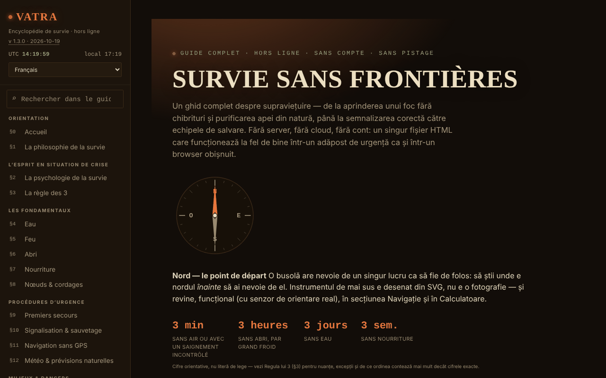

# VATRA — L'encyclopédie de la survie

[English](README.md) · [Română](README.ro.md) · **Français** · [Italiano](README.it.md) · [Español](README.es.md) · [Português](README.pt.md) · [Deutsch](README.de.md) · [Magyar](README.hu.md)

**Version :** 1.3.9 · **Dernière mise à jour :** 2026-10-23

Langues de l'interface : **Română, English, Français, Italiano, Español, Português (PT), Deutsch, Magyar**

**Application en ligne / démo :** https://chiuta.github.io/VATRA/

Guide de survie dans un seul fichier HTML (`index.html`), en 8 langues : ~21 sections (eau, feu, abri, nourriture, nœuds, premiers secours, signalisation, navigation sans GPS, météo, milieux, catastrophes, faune dangereuse, ressources pour la Roumanie), trousse d'urgence interactive, calculateurs (eau, calories, hypothermie/hyperthermie, azimut), boussole, glossaire et test de connaissances.

**Langues :** toutes les sections du guide, le glossaire et le quiz de connaissances sont disponibles dans les 8 langues ; les noms propres officiels (Salvamont, RO-ALERT, etc.), les symboles Morse, les chiffres/codes et les noms scientifiques latins restent tels quels. Les traductions sont automatiques, non vérifiées par des locuteurs natifs ; **le contenu de premiers secours (RCP, hémorragie/garrot, hypothermie, hyperthermie, brûlures, morsures de serpent/tiques, choc), les doses de purification de l'eau (iode, chlore, SODIS), les plantes/champignons comestibles et le test de comestibilité, ainsi que les règles légales et numéros d'urgence de Roumanie (112, SMS 113, Salvamont, RO-ALERT) doivent être relus par un spécialiste** ; ce sont des traductions fidèles, sans conseil ajouté. La question de quiz en cours ne se rafraîchit qu'à la question suivante après un changement de langue.

**Contenu éducatif général ; il ne remplace ni un cours certifié de premiers secours ou de survie, ni les secours locaux, ni une évaluation médicale spécialisée.** En cas d'urgence, en Roumanie, appelez le 112. Les informations du guide (y compris chiffres, numéros de contact, données sur la faune ou la législation) peuvent devenir obsolètes ; vérifiez les sources officielles. Les calculateurs sont indicatifs.

## Utilisation
Recherchez dans tout le guide depuis le champ de la barre latérale (raccourci `/`).
Ouvrez `index.html` dans un navigateur (ou la version publiée via GitHub Pages) ; il fonctionne hors ligne. Thème « Nuit »/« Jour » dans la barre latérale (le choix est conservé). Les cases cochées de la trousse, vos propres notes, la progression du test et le thème sont enregistrés automatiquement en local dans le navigateur (`localStorage`, clé `vatra:v1`) ; vous pouvez les supprimer depuis la barre latérale (« Supprimer les données enregistrées dans le navigateur ») ou les exporter/importer sous forme de fichier.

## Nouvelles fonctions (v1.1.0, 14 octobre 2026)

Aucune nouvelle fonction d'apprentissage dans cette version : **la répétition espacée existe déjà** (§19 Test de connaissances, « Mode : Répétition espacée », avec export/import de la progression) et n'a pas été dupliquée. Le seul ajout est le kit ci-dessous.

### Transparence et sauvegarde (fff-kit)

Un clic (ou Entrée) sur la version affichée (`v 1.1.0 · 2026-10-14`) ouvre la fenêtre « Transparence » : les hôtes réseau déclarés (0 requête externe), les clés de stockage local avec leurs tailles, les API utilisées, la taille et le SHA-256 du fichier (avec un vérificateur pour un fichier téléchargé) et la **sauvegarde** des données de l'application dans un fichier `.fff.json` (éventuellement chiffré par mot de passe, AES-GCM 256 / PBKDF2 ; le mot de passe ne peut pas être récupéré), l'import avec confirmation et la suppression des données de l'application. Le kit (`fff-kit`, modules : core, label, bundle) est collé dans `index.html`, n'effectue aucune requête réseau et ne modifie pas les données existantes ; sans lui, l'application fonctionne de la même façon. La sauvegarde du kit inclut la clé de stockage facultative de l'application (si vous avez activé la conservation sur l'appareil), mais pas la progression du test, qui s'exporte via « Exporter la progression ». Les textes du kit sont en 8 langues (ro, en, fr, it, es, pt, hu, de) ; **les traductions fr/it/es/pt/hu/de sont automatiques et non vérifiées par des locuteurs natifs**. L'interface et le contenu de l'application sont aussi disponibles dans les 8 langues (voir la note sur les langues en haut) ; les traductions du contenu sont automatiques, non vérifiées par des locuteurs natifs.

## Données et confidentialité
Vérifié par audit : la page n'effectue aucune requête réseau (0 requête au chargement, pas de `fetch`/CDN/polices externes) et n'envoie rien nulle part ; le seul stockage est le `localStorage` local (clé `vatra:v1`, avec les cases cochées de la trousse, les notes, la progression du test et le thème), aussi privé que le fichier lui-même. La géolocalisation (le bouton du calculateur d'azimut) n'est utilisée que sur demande, en local. Les liens externes (Salvamont, RO-ALERT, Croix-Rouge, etc.) ne s'ouvrent qu'au clic. Elle applique une politique CSP stricte (meta) : aucune connexion réseau (`connect-src 'none'`), script autorisé uniquement par hash SHA-256 (sans `unsafe-inline` pour les scripts), styles en ligne.

## Limites
- Sources citées en partie seulement (sans références bibliographiques détaillées) ; l'estimation de la population d'ours a désormais une source (AGERPRES, 10 avril 2025) ; la législation sur l'intervention concernant les ours change souvent (OUG 60/2025 et la loi qui a suivi) et n'est pas citée article par article : consultez legislatie.just.ro.
- Le test de comestibilité et les procédures de premiers secours sont des résumés généraux, pas des protocoles médicaux.

## Licence

MIT — voir le fichier `LICENSE`. © 2026 Alexandru-Ionuț Chiuță (Alexio). Les éventuelles bibliothèques tierces incluses dans le fichier conservent leurs propres licences.

Le lien « Signaler une erreur » (GitHub) pointe désormais vers `chiuta/vatra`. Les indications médicales/de survie (y compris le test universel de comestibilité, marqué « plantes uniquement, dernier recours ») restent du contenu de l'auteur, avec l'avertissement figurant dans la page et ci-dessus.

Audit : 2026-10-10

## Historique / Changelog

### 1.3.9 — 2026-10-23
- fff-kit 1.2.0 : la confirmation « réinitialiser la liste de contrôle » utilise désormais le dialogue accessible commun du kit (FFF.dialog) ; la copie propre du code de dialogue (y compris son repli sur `confirm` natif) a été supprimée. Comportement et traductions inchangés.

### 1.3.7 — 2026-10-22
- fff-kit 1.1.4 : cibles tactiles et taille de texte minimale; cibles tactiles/texte corrigés

### 1.3.6 — 2026-10-22
- Accessibilité : le champ de recherche affiche désormais un anneau de focus net (contraste d’au moins 3:1) dans les thèmes nuit et jour.

### 1.3.5 — 2026-10-22
- fff-kit 1.1.2 : PBKDF2 à 600 000 itérations, protection anti-clickjacking.

### 1.3.4 — 2026-10-22
- La confirmation de réinitialisation de la liste de contrôle est une boîte de dialogue modale traduite au lieu du confirm() du navigateur.
- Accessibilité : les quatre champs d'import (sauvegarde, liste de contrôle, progression des révisions, notes) ont des noms annoncés par les lecteurs d'écran.
- Mobile : le texte fait au moins 12 px et les boutons et champs ont des cibles tactiles plus grandes sur les écrans étroits.

### 1.3.3 — 2026-10-22
- dans l'interface roumaine, les termes du glossaire, nœuds et options de quiz restés en anglais (sunk cost, debris hut, clove hitch, rolling hitch, bear spray, lean-to, PLB, etc.) ont désormais des noms roumains avec le terme anglais entre parenthèses ; « Home » dans la navigation italienne devient « Inizio ».

### 1.3.2 — 2026-10-22
- La méta-description et la description du panneau de transparence fff-kit suivent désormais la langue de l'interface (auparavant uniquement en roumain).

### 1.3.1 — 2026-10-19
- Tout le guide, le glossaire et le quiz sont traduits en en, fr, it, es, pt, de, hu (le fichier passe à environ 1,5 Mo) ; l'interface n'est plus seulement en roumain. Le contenu médical/de survie doit être relu par un spécialiste.

### 1.2.0 — 2026-10-19
- Nouveau : dans le calculateur « Azimut et distance », le lien « ↗ Le ciel en ce moment, dans Bolta » (position issue des champs, arrondie à ~1 km ; ouverture dans un nouvel onglet ; avertissement sur l'historique).

### 1.1.0 — 2026-10-14
- fff-kit : la fenêtre « Transparence » (clic sur la version) et la sauvegarde unifiée `.fff.json`. Le contenu et la répétition espacée n'ont pas changé.

### 1.0.4 — 2026-10-12
- La version et la date de la dernière mise à jour sont affichées dans l'application (barre latérale).

### 1.0.3 — 11 octobre 2026 (série 7)
- Nouveau : recherche dans tout le guide (champ dans la barre latérale, raccourci `/` ; insensible aux diacritiques, résultats avec extrait et saut vers le passage trouvé).
- Corrigé : sur les sections autres que l'Accueil, la page n'avait aucun titre de niveau 1 (axe-core `page-has-heading-one`) ; désormais l'en-tête « VATRA » de la barre latérale devient un titre de niveau 1 en dehors de la page d'Accueil.

### 1.0.2 — 11 octobre 2026 (série 6)
- Ajouté : enregistrement local automatique de la trousse, des notes, de la progression du test et du thème (avec bouton de suppression) ; CSP avec `script-src` par hash.

### 1.0.1 — 11 octobre 2026
- Corrigé : le titre du hero n'affiche plus de caractères aléatoires pendant l'animation (effet de révélation ; le texte final est toujours dans la page).
- Corrigé : accessibilité : l'en-tête mobile est un `<header>`, les titres du pied de page sont des h3 (ordre correct) ; 0 violation axe-core à 1280 et 360 px.
- Ajouté : politique CSP stricte ; version 1.0.1 affichée dans la barre latérale.
- Mis à jour : données sur les ours vérifiées le 11.10.2026 (source : AGERPRES, 10.04.2025) ; la formulation sur la législation n'affirme plus une modification non vérifiée de mai 2026. Sources vérifiées le 11.10.2026.

