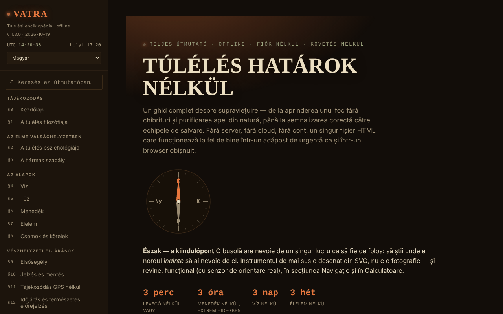

# VATRA — A túlélés enciklopédiája

[English](README.md) · [Română](README.ro.md) · [Français](README.fr.md) · [Italiano](README.it.md) · [Español](README.es.md) · [Português](README.pt.md) · [Deutsch](README.de.md) · **Magyar**

**Verzió:** 2.2.0 · **Utolsó frissítés:** 2026-10-27

**Állapot:** stabil · **Offline:** teljes

A felület nyelvei: **Română, English, Français, Italiano, Español, Português (PT), Deutsch, Magyar**

**Online alkalmazás / demó:** https://chiuta.github.io/VATRA/

Túlélési útmutató egyetlen HTML-fájlban (`index.html`), 8 nyelven: ~21 szakasz (víz, tűz, menedék, élelem, csomók, elsősegély, jelzés, navigáció GPS nélkül, időjárás, élőhelyek, katasztrófák, veszélyes állatok, erőforrások Romániához), interaktív vészhelyzeti készlet, számológépek (víz, kalória, hipotermia/hipertermia, azimut), iránytű, szójegyzék és tudáspróba.

**Nyelvek:** az útmutató összes szakasza, a szójegyzék és a tudáskvíz mind a 8 nyelven elérhető; a hivatalos tulajdonnevek (Salvamont, RO-ALERT stb.), a morzejelek, a számok/kódok és a latin tudományos nevek változatlanul marad. A fordítások automatikusak, anyanyelvi beszélők nem ellenőrizték; **az elsősegély-tartalom (újraélesztés, vérzés/érszorító, kihűlés, túlmelegedés, égések, kígyó-/kullancsharapás, sokk), a vízfertőtlenítési adagok (jód, klór, SODIS), az ehető növények/gombák és az ehetőségi próba, valamint a romániai jogszabályok és segélyhívó számok (112, 113-as SMS, Salvamont, RO-ALERT) szakmai felülvizsgálatot igényelnek**; hű fordítások, hozzáadott tanács nélkül. A folyamatban lévő kvízkérdés nyelvváltás után csak a következő kérdésnél frissül.

**Általános oktatási tartalom; nem helyettesíti a tanúsított elsősegély- vagy túlélőtanfolyamot, a helyi mentőcsapatot, sem a szakorvosi értékelést.** Vészhelyzetben Romániában hívd a 112-t. Az útmutató információi (beleértve a számadatokat, elérhetőségeket, az állatvilágra vagy a jogszabályokra vonatkozó adatokat) elavulhatnak; ellenőrizd a hivatalos forrásokat. A számológépek tájékoztató jellegűek.

## Használat
Keress az egész útmutatóban az oldalsáv mezőjében (gyorsbillentyű: `/`).
Nyisd meg az `index.html` fájlt egy böngészőben (vagy a GitHub Pages-en közzétett változatot); offline is működik. „Éjszaka”/„Nappal” téma az oldalsávban (a választás megmarad). A készlet pipái, a saját jegyzeteid, a teszt előrehaladása és a téma automatikusan, helyben mentődnek a böngészőben (`localStorage`, `vatra:v1` kulcs); az oldalsávból törölheted őket („A böngészőben mentett adatok törlése”), vagy exportálhatod/importálhatod fájlként.

## Új funkciók (v1.1.0, 2026. október 14.)

Ebben a verzióban nincs új tanulási funkció: **az elosztott ismétlés már létezik** (19. § Tudáspróba, „Mód: Elosztott ismétlés”, az előrehaladás exportjával/importjával), és nem duplikáltuk. Az egyetlen kiegészítés az alábbi készlet.

### Átláthatóság és biztonsági mentés (fff-kit)

A megjelenített verzióra (`v 1.1.0 · 2026-10-14`) kattintva (vagy Entert nyomva) megnyílik az „Átláthatóság” ablak: a deklarált hálózati hosztok (0 külső kérés), a helyi tárolókulcsok méretekkel, a használt API-k, a fájl mérete és SHA-256 ujjlenyomata (ellenőrzővel egy letöltött fájlhoz), valamint az alkalmazás adatainak **biztonsági mentése** `.fff.json` fájlba (opcionálisan jelszóval titkosítva, AES-GCM 256 / PBKDF2; a jelszó nem állítható vissza), importálás megerősítéssel és az alkalmazás adatainak törlése. A készlet (`fff-kit`, modulok: core, label, bundle) be van illesztve az `index.html`-be, nem küld hálózati kéréseket, és nem módosítja a meglévő adatokat; nélküle az alkalmazás ugyanúgy működik. A készlet biztonsági mentése tartalmazza az alkalmazás opcionális tárolókulcsát (ha bekapcsoltad az eszközön való megőrzést), a teszt előrehaladását nem, amelyet az „Előrehaladás exportálása” gombbal lehet exportálni. A készlet szövegei 8 nyelven érhetők el (ro, en, fr, it, es, pt, hu, de); **az fr/it/es/pt/hu/de fordítások automatikusak, anyanyelvi beszélők nem ellenőrizték őket**. Az alkalmazás felülete és tartalma szintén elérhető a 8 nyelven (lásd az elején a nyelvi megjegyzést); a tartalom fordításai automatikusak, anyanyelvi beszélők nem ellenőrizték.

## Adatok és adatvédelem
Auditálással ellenőrizve: az oldal nem küld hálózati kéréseket (betöltéskor 0 kérés, nincs `fetch`/CDN/külső betűtípus), és sehová nem küld semmit; az egyetlen tárolás a helyi `localStorage` (`vatra:v1` kulcs, a készlet pipáival, a jegyzetekkel, a teszt előrehaladásával és a témával), éppoly privát, mint maga a fájl. A helymeghatározást (az azimut-számológép gombja) csak kérésre, helyben használja. A külső hivatkozások (Salvamont, RO-ALERT, Vöröskereszt stb.) csak kattintásra nyílnak meg. Szigorú CSP-szabályzata van (meta): nincs hálózati kapcsolat (`connect-src 'none'`), szkript csak SHA-256 hash alapján engedélyezett (szkriptekhez nincs `unsafe-inline`), beágyazott stílusok.

## Korlátok
- A források csak részben vannak idézve (részletes irodalmi hivatkozások nélkül); a medvepopuláció becslésének már van forrása (AGERPRES, 2025. április 10.); a medvékkel kapcsolatos beavatkozásra vonatkozó jogszabályok gyakran változnak (a 60/2025. sz. sürgősségi kormányrendelet és az azt követő törvény), és cikkelyenként nincsenek idézve: ellenőrizd a legislatie.just.ro oldalon.
- Az ehetőségi teszt és az elsősegély-eljárások általános összefoglalók, nem orvosi protokollok.

## Licenc

MIT — lásd a `LICENSE` fájlt. © 2026 Alexandru-Ionuț Chiuță (Alexio). A fájlba esetlegesen beépített külső könyvtárak megtartják saját licencüket.

A „Hiba jelentése” hivatkozás (GitHub) mostantól a `chiuta/vatra` tárolóra mutat. Az orvosi/túlélési útmutatások (beleértve az egyetemes ehetőségi tesztet, amely „csak növények, végső megoldás” jelöléssel szerepel) a szerző tartalmai maradnak, az oldalon és fent szereplő figyelmeztetéssel.

Audit: 2026-10-10

## Zsebkártya és telepítés (v2.1.0)

A **Zsebkártya nyomtatása** gomb (oldalsáv) egyetlen zsebkártyát nyomtat (A4, a pontozott vonal mentén kivágható) a hármas szabállyal, a döntések sorrendjével, a jelzésekkel és a 112-es hívás menetével a kiválasztott nyelven; az útmutató többi része nem nyomtatódik. A szövegek az útmutatóból származnak, így szinkronban maradnak. **Telepítés alkalmazásként (PWA):** a manifest és a service worker már megvolt; most megjelenik a **Telepítés alkalmazásként** gomb, ha a böngésző felajánlja, különben szöveges útmutató (csak a közzétett https oldalról működik, helyi fájlból nem). Inline (blob) manifestet nem használtunk: ehhez lazítani kellene a `manifest-src` irányelvet.

## Pocket card with your own details (2.2.0)

_(English only; not yet translated into this language. Machine translation intentionally not added to avoid errors in technical statements.)_

If you filled in the **emergency note** (name, contacts, medical details, route, vehicle) and/or generated the **plan** in the app, the pocket card adds a block "My details (filled in by you in VATRA; not part of the guide)" when printing: the filled fields and the plan summary (environment, season, ticked gear). The block is emptied after printing (`afterprint`); the data stay in the app only, as before, and are sent nowhere. Your text is escaped (not interpreted as HTML). With nothing filled in, the card is identical to 2.1.

**Unchanged and why:** the "inline" (blob) PWA manifest was NOT done: `manifest.webmanifest` and `sw.js` already exist, and an inline manifest would require relaxing `manifest-src` in the CSP. The map and the kit are not on the card. The A4 fit was checked with `print` media emulation, not with a real printer. The new label in fr/it/es/pt/de/hu is a machine translation.

## Előzmények / Changelog

### 2.2.0 — 2026-10-27
- The pocket card optionally includes the user's emergency note and plan summary.

- **2.1.0 — 2026-10-27:** nyomtatható zsebkártya (CSS `@media print`) és PWA-telepítő gomb; Állapot/Offline sorok; CHANGELOG.md (előző: v2.0.0).

### 1.3.10 — 2026-10-23
- Hőindex: most a teljes NWS-algoritmust követi (előbb az egyszerű képlet, a Rothfusz-regresszió csak 80 °F-tól, plusz a két dokumentált korrekció nagyon alacsony és nagyon magas páratartalomra); korábban a 27 °C-os küszöb körüli és a < 13 % vagy > 85 % páratartalmú értékek kissé eltértek.
- Személyes jegyzetek: legfeljebb 500 jegyzet (visszaállítás, import és kézi hozzáadás), hogy egy rosszindulatú fájl vagy mentés ne fagyaszthassa le az oldalt és ne tölthesse meg a tárhelyet.
- Érintőképernyőn (`pointer: coarse`) a menü-, téma- és nyelvvezérlők 44 px-es érintési célpontot kapnak.

### 1.3.9 — 2026-10-23
- fff-kit 1.2.0: a „ellenőrzőlista visszaállítása” megerősítés mostantól a készlet közös, akadálymentes párbeszédablakát (FFF.dialog) használja; az alkalmazás saját párbeszédkód-másolata (a natív `confirm` tartalékkal együtt) törölve. A működés és a fordítások változatlanok.

### 1.3.7 — 2026-10-22
- fff-kit 1.1.4: érintési célpontok és minimális szövegméret; érintési célpontok/szöveg javítva

### 1.3.6 — 2026-10-22
- Akadálymentesség: a keresőmező mostantól jól látható fókuszkeretet mutat (legalább 3:1 kontraszt) az éjszakai és a nappali témában is.

### 1.3.5 — 2026-10-22
- fff-kit 1.1.2: PBKDF2 600 000 iterációval, clickjacking elleni védelem.

### 1.3.4 — 2026-10-22
- Az ellenőrzőlista visszaállításának megerősítése lefordított modális párbeszédablak a böngésző confirm() helyett.
- Kisegítő lehetőségek: a négy importmező (mentés, ellenőrzőlista, ismétlési előrehaladás, jegyzetek) neve felolvasható a képernyőolvasókkal.
- Mobil: a szöveg legalább 12 px, a gombok és mezők érintési felülete pedig nagyobb keskeny képernyőn.

### 1.3.3 — 2026-10-22
- a román felületen az angolul maradt szószedeti kifejezések, csomók és kvízopciók (sunk cost, debris hut, clove hitch, rolling hitch, bear spray, lean-to, PLB stb.) most román névvel szerepelnek, az angol kifejezés zárójelben; az olasz navigációban a „Home” helyett „Inizio” áll.

### 1.3.2 — 2026-10-22
- A meta leírás és az fff-kit átláthatósági panel leírása mostantól a felület nyelvét követi (korábban csak románul volt).

### 1.3.1 — 2026-10-19
- Az egész útmutató, a szójegyzék és a kvíz le van fordítva en, fr, it, es, pt, de, hu nyelvre (a fájl kb. 1,5 MB-ra nő); a felület már nem csak román. Az orvosi/túlélési tartalom szakmai felülvizsgálatot igényel.

### 1.2.0 — 2026-10-19
- Új: az „Azimut és távolság” számológépben a „↗ Az égbolt most, a Boltában” hivatkozás (a mezőkben megadott pozíció, ~1 km-re kerekítve; új lapon nyílik meg; figyelmeztetés az előzményekre).

### 1.1.0 — 2026-10-14
- fff-kit: az „Átláthatóság” ablak (kattintás a verzióra) és az egységes `.fff.json` biztonsági mentés. A tartalom és az elosztott ismétlés nem változott.

### 1.0.4 — 2026-10-12
- A verzió és az utolsó frissítés dátuma megjelenik az alkalmazásban (oldalsáv).

### 1.0.3 — 2026. október 11. (7. kör)
- Új: keresés az egész útmutatóban (mező az oldalsávban, gyorsbillentyű: `/`; ékezetfüggetlen, találatok részlettel és ugrással a megtalált szakaszra).
- Javítva: a Kezdőlapon kívüli szakaszokon az oldalnak nem volt 1. szintű címsora (axe-core `page-has-heading-one`); mostantól az oldalsáv „VATRA” fejléce 1. szintű címsorrá válik a Kezdőlapon kívül.

### 1.0.2 — 2026. október 11. (6. kör)
- Hozzáadva: a készlet, a jegyzetek, a teszt előrehaladásának és a témának automatikus helyi mentése (törlőgombbal); CSP `script-src` hash alapján.

### 1.0.1 — 2026. október 11.
- Javítva: a hero cím már nem mutat véletlen karaktereket az animáció alatt (felfedő effekt; a végleges szöveg mindig az oldalon van).
- Javítva: akadálymentesség: a mobil fejléc `<header>`, a lábléc címsorai h3 (helyes sorrend); 0 axe-core-szabálysértés 1280 és 360 px szélességen.
- Hozzáadva: szigorú CSP-szabályzat; az 1.0.1-es verzió megjelenik az oldalsávban.
- Frissítve: a medvékre vonatkozó adatok 2026.10.11-én ellenőrizve (forrás: AGERPRES, 2025.04.10.); a jogszabályokról szóló megfogalmazás már nem állít ellenőrizetlen 2026. májusi módosítást. Források 2026.10.11-én ellenőrizve.

