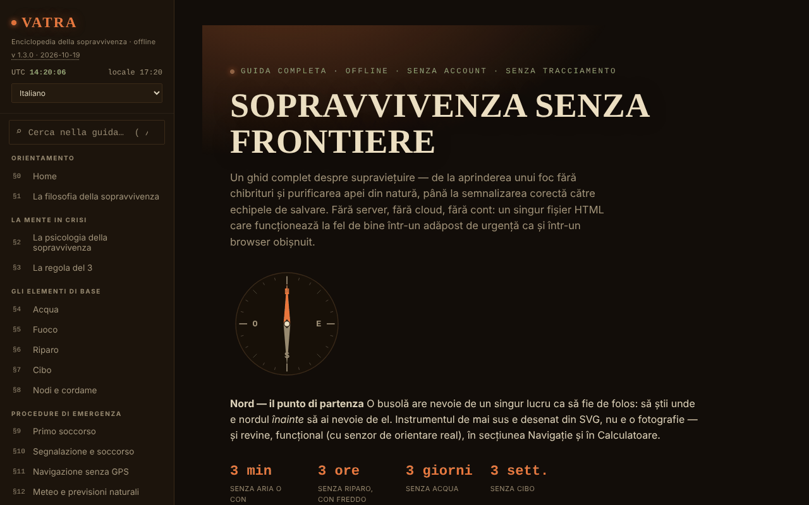

# VATRA — L'enciclopedia della sopravvivenza

[English](README.md) · [Română](README.ro.md) · [Français](README.fr.md) · **Italiano** · [Español](README.es.md) · [Português](README.pt.md) · [Deutsch](README.de.md) · [Magyar](README.hu.md)

**Versione:** 1.3.10 · **Ultimo aggiornamento:** 2026-10-23

Lingue dell'interfaccia: **Română, English, Français, Italiano, Español, Português (PT), Deutsch, Magyar**

**Applicazione online / demo:** https://chiuta.github.io/VATRA/

Guida di sopravvivenza in un unico file HTML (`index.html`), in 8 lingue: ~21 sezioni (acqua, fuoco, riparo, cibo, nodi, primo soccorso, segnalazione, navigazione senza GPS, meteo, ambienti, disastri, fauna pericolosa, risorse per la Romania), kit di emergenza interattivo, calcolatori (acqua, calorie, ipotermia/ipertermia, azimut), bussola, glossario e quiz di verifica.

**Lingue:** tutte le sezioni della guida, il glossario e il quiz di conoscenze sono disponibili nelle 8 lingue; i nomi propri ufficiali (Salvamont, RO-ALERT ecc.), i simboli Morse, le cifre/i codici e i nomi scientifici latini restano invariati. Le traduzioni sono automatiche, non verificate da madrelingua; **i contenuti di primo soccorso (RCP, emorragia/laccio, ipotermia, ipertermia, ustioni, morsi di serpente/zecche, shock), le dosi di potabilizzazione dell'acqua (iodio, cloro, SODIS), le piante/i funghi commestibili e il test di commestibilità, nonché le norme legali e i numeri di emergenza della Romania (112, SMS 113, Salvamont, RO-ALERT) richiedono la revisione di uno specialista**; sono traduzioni fedeli, senza consigli aggiunti. La domanda del quiz in corso si aggiorna solo alla domanda successiva dopo un cambio di lingua.

**Contenuto educativo generale; non sostituisce un corso certificato di primo soccorso o di sopravvivenza, i soccorsi locali o una valutazione medica specialistica.** In caso di emergenza, in Romania, chiama il 112. Le informazioni della guida (comprese cifre, numeri di contatto, dati su fauna o legislazione) possono diventare obsolete; verifica le fonti ufficiali. I calcolatori sono indicativi.

## Utilizzo
Cerca in tutta la guida dal campo nella barra laterale (scorciatoia `/`).
Apri `index.html` in un browser (oppure la versione pubblicata tramite GitHub Pages); funziona offline. Tema «Notte»/«Giorno» nella barra laterale (la scelta viene ricordata). Le spunte del kit, le note personali, i progressi del quiz e il tema vengono salvati automaticamente in locale nel browser (`localStorage`, chiave `vatra:v1`); puoi eliminarli dalla barra laterale («Elimina i dati salvati nel browser») oppure esportarli/importarli come file.

## Nuove funzioni (v1.1.0, 14 ottobre 2026)

Nessuna nuova funzione di apprendimento in questa versione: **la ripetizione dilazionata esiste già** (§19 Quiz di verifica, «Modalità: Ripetizione dilazionata», con esportazione/importazione dei progressi) e non è stata duplicata. L'unica aggiunta è il kit qui sotto.

### Trasparenza e copia di sicurezza (fff-kit)

Un clic (o Invio) sulla versione mostrata (`v 1.1.0 · 2026-10-14`) apre la finestra «Trasparenza»: gli host di rete dichiarati (0 richieste esterne), le chiavi di archiviazione locale con le dimensioni, le API usate, la dimensione e lo SHA-256 del file (con un verificatore per un file scaricato) e la **copia di sicurezza** dei dati dell'applicazione in un file `.fff.json` (facoltativamente cifrato con password, AES-GCM 256 / PBKDF2; la password non può essere recuperata), l'importazione con conferma e l'eliminazione dei dati dell'applicazione. Il kit (`fff-kit`, moduli: core, label, bundle) è incollato in `index.html`, non effettua richieste di rete e non modifica i dati esistenti; senza di esso l'applicazione funziona allo stesso modo. La copia di sicurezza del kit comprende la chiave di archiviazione facoltativa dell'applicazione (se hai attivato la conservazione sul dispositivo), non i progressi del quiz, che si esportano con «Esporta i progressi». I testi del kit sono in 8 lingue (ro, en, fr, it, es, pt, hu, de); **le traduzioni fr/it/es/pt/hu/de sono automatiche e non verificate da madrelingua**. L'interfaccia e i contenuti dell'app sono disponibili anche nelle 8 lingue (vedi la nota sulle lingue in alto); le traduzioni dei contenuti sono automatiche, non verificate da madrelingua.

## Dati e privacy
Verificato tramite audit: la pagina non effettua richieste di rete (0 richieste al caricamento, nessun `fetch`/CDN/font esterno) e non invia nulla da nessuna parte; l'unica archiviazione è il `localStorage` locale (chiave `vatra:v1`, con le spunte del kit, le note, i progressi del quiz e il tema), privato quanto il file stesso. La geolocalizzazione (il pulsante nel calcolatore di azimut) viene usata solo su richiesta, in locale. I link esterni (Salvamont, RO-ALERT, Croce Rossa ecc.) si aprono solo al clic. Ha una policy CSP rigorosa (meta): nessuna connessione di rete (`connect-src 'none'`), script consentito solo tramite hash SHA-256 (senza `unsafe-inline` per gli script), stili inline.

## Limiti
- Fonti citate solo in parte (senza riferimenti bibliografici dettagliati); la stima della popolazione di orsi ora ha una fonte (AGERPRES, 10 aprile 2025); la legislazione sull'intervento riguardo agli orsi cambia spesso (OUG 60/2025 e la legge successiva) e non è citata articolo per articolo: verifica legislatie.just.ro.
- Il test di commestibilità e le procedure di primo soccorso sono riassunti generali, non protocolli medici.

## Licenza

MIT — vedi il file `LICENSE`. © 2026 Alexandru-Ionuț Chiuță (Alexio). Eventuali librerie di terze parti incluse nel file mantengono le proprie licenze.

Il link «Segnala un errore» (GitHub) ora rimanda a `chiuta/vatra`. Le indicazioni mediche/di sopravvivenza (compreso il test universale di commestibilità, contrassegnato «solo piante, ultima risorsa») restano contenuto dell'autore, con l'avvertenza presente nella pagina e qui sopra.

Audit: 2026-10-10

## Cronologia / Changelog

### 1.3.10 — 2026-10-23
- Indice di calore: segue ora l'algoritmo NWS completo (prima la formula semplice, la regressione di Rothfusz solo quando raggiunge 80 °F, più le due correzioni documentate per umidità molto bassa e molto alta); prima, i valori vicini alla soglia di 27 °C e con umidità < 13 % o > 85 % erano leggermente spostati.
- Note personali: al massimo 500 note (ripristino, importazione e aggiunta manuale), così un file o un backup ostile non può bloccare la pagina o riempire l'archivio.
- Sugli schermi tattili (`pointer: coarse`) i controlli di menu, tema e lingua hanno un'area tattile di 44 px.

### 1.3.9 — 2026-10-23
- fff-kit 1.2.0: la conferma «reimposta la lista di controllo» usa ora il dialogo accessibile comune del kit (FFF.dialog); la copia propria del codice del dialogo (compresa l'alternativa con `confirm` nativo) è stata rimossa. Comportamento e traduzioni invariati.

### 1.3.7 — 2026-10-22
- fff-kit 1.1.4: bersagli touch e testo minimo; bersagli touch/testo corretti

### 1.3.6 — 2026-10-22
- Accessibilità: il campo di ricerca mostra ora un anello di focus chiaro (contrasto di almeno 3:1) nei temi notte e giorno.

### 1.3.5 — 2026-10-22
- fff-kit 1.1.2: PBKDF2 a 600.000 iterazioni, protezione anti-clickjacking.

### 1.3.4 — 2026-10-22
- La conferma di reimpostazione della checklist è una finestra modale tradotta invece del confirm() del browser.
- Accessibilità: i quattro campi di importazione (backup, checklist, progressi di ripasso, note) hanno nomi annunciati dagli screen reader.
- Mobile: il testo è di almeno 12 px e pulsanti e campi hanno aree tattili più grandi sugli schermi stretti.

### 1.3.3 — 2026-10-22
- nell'interfaccia rumena i termini del glossario, i nodi e le opzioni del quiz rimasti in inglese (sunk cost, debris hut, clove hitch, rolling hitch, bear spray, lean-to, PLB, ecc.) hanno ora nomi rumeni con il termine inglese tra parentesi; «Home» nella navigazione italiana diventa «Inizio».

### 1.3.2 — 2026-10-22
- La meta descrizione e la descrizione del pannello di trasparenza fff-kit seguono ora la lingua dell'interfaccia (prima solo in rumeno).

### 1.3.1 — 2026-10-19
- Tutta la guida, il glossario e il quiz sono tradotti in en, fr, it, es, pt, de, hu (il file cresce a circa 1,5 MB); l'interfaccia non è più solo in rumeno. Il contenuto medico/di sopravvivenza richiede la revisione di uno specialista.

### 1.2.0 — 2026-10-19
- Novità: nel calcolatore «Azimut e distanza», il link «↗ Il cielo di adesso, in Bolta» (posizione dai campi, arrotondata a ~1 km; apertura in una nuova scheda; avviso sulla cronologia).

### 1.1.0 — 2026-10-14
- fff-kit: la finestra «Trasparenza» (clic sulla versione) e la copia di sicurezza unificata `.fff.json`. Il contenuto e la ripetizione dilazionata non sono cambiati.

### 1.0.4 — 2026-10-12
- La versione e la data dell'ultimo aggiornamento sono mostrate nell'applicazione (barra laterale).

### 1.0.3 — 11 ottobre 2026 (round 7)
- Novità: ricerca in tutta la guida (campo nella barra laterale, scorciatoia `/`; senza distinzione dei diacritici, risultati con frammento e salto al passaggio trovato).
- Corretto: nelle sezioni diverse da Home la pagina non aveva alcun titolo di livello 1 (axe-core `page-has-heading-one`); ora l'intestazione «VATRA» della barra laterale diventa titolo di livello 1 fuori dalla pagina Home.

### 1.0.2 — 11 ottobre 2026 (round 6)
- Aggiunto: salvataggio locale automatico di kit, note, progressi del quiz e tema (con pulsante di eliminazione); CSP con `script-src` tramite hash.

### 1.0.1 — 11 ottobre 2026
- Corretto: il titolo dell'hero non mostra più caratteri casuali durante l'animazione (effetto di rivelazione; il testo finale è sempre nella pagina).
- Corretto: accessibilità: l'intestazione mobile è un `<header>`, i titoli del piè di pagina sono h3 (ordine corretto); 0 violazioni axe-core a 1280 e 360 px.
- Aggiunto: policy CSP rigorosa; versione 1.0.1 mostrata nella barra laterale.
- Aggiornato: dati sugli orsi verificati l'11.10.2026 (fonte: AGERPRES, 10.04.2025); la formulazione sulla legislazione non afferma più una modifica non verificata di maggio 2026. Fonti verificate l'11.10.2026.

