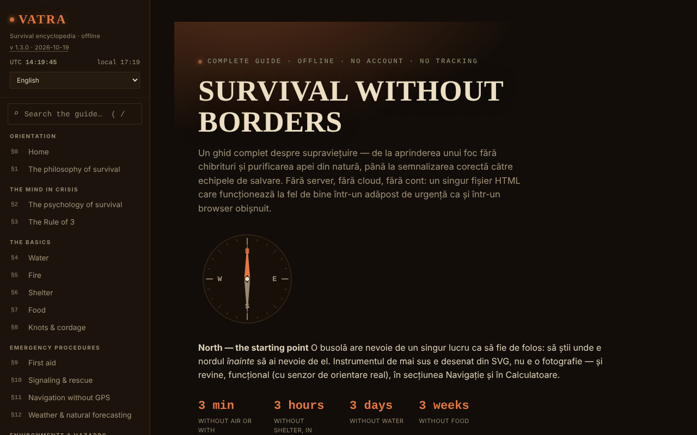

# VATRA — The Survival Encyclopedia

**English** · [Română](README.ro.md) · [Français](README.fr.md) · [Italiano](README.it.md) · [Español](README.es.md) · [Português](README.pt.md) · [Deutsch](README.de.md) · [Magyar](README.hu.md)

**Version:** 1.3.1 · **Last updated:** 2026-10-19

Interface languages: **Română, English, Français, Italiano, Español, Português (PT), Deutsch, Magyar**

**Live / demo:** https://chiuta.github.io/VATRA/

A survival guide in a single HTML file (`index.html`), in Romanian: ~21 sections (water, fire, shelter, food, knots, first aid, signalling, navigation without GPS, weather, environments, disasters, dangerous fauna, resources for Romania), an interactive emergency kit, calculators (water, calories, hypothermia/hyperthermia, azimuth), a compass, a glossary and a knowledge quiz.

**General educational content; it does not replace a certified first-aid or survival course, the local rescue team or specialist medical assessment.** In an emergency, in Romania, call 112. The information in the guide (including figures, contact numbers, data on fauna or legislation) may become outdated; check the official sources. The calculators are indicative.

## Usage
Search the whole guide from the field in the sidebar (shortcut `/`).
Open `index.html` in a browser (or the version published through GitHub Pages); it works offline. "Night"/"Day" theme in the sidebar (the choice is remembered). The kit checkmarks, your own notes, the quiz progress and the theme are saved automatically, locally in the browser (`localStorage`, key `vatra:v1`); you can delete them from the sidebar ("Delete data saved in the browser") or export/import them as a file.

## New features (v1.1.0, 14 October 2026)

No new learning features in this version: **spaced repetition already exists** (§19 Knowledge quiz, "Mode: Spaced repetition", with progress export/import) and was not duplicated. The only addition is the kit below.

### Transparency and backup (fff-kit)

A click (or Enter) on the displayed version (`v 1.1.0 · 2026-10-14`) opens the "Transparency" window: the declared network hosts (0 external requests), the local storage keys with sizes, the APIs used, the size and SHA-256 of the file (with a checker for a downloaded file) and the **backup** of the app's data to a `.fff.json` file (optionally encrypted with a password, AES-GCM 256 / PBKDF2; the password cannot be recovered), import with confirmation and deletion of the app's data. The kit (`fff-kit`, modules: core, label, bundle) is pasted into `index.html`, makes no network requests and does not change existing data; without it the app works the same. The kit's backup covers the app's optional storage key (if you enabled keeping data on the device), not the quiz progress, which is exported through "Export progress". The kit's texts are in 8 languages (ro, en, fr, it, es, pt, hu, de); **the fr/it/es/pt/hu/de translations are automatic and not verified by native speakers**. The app's own interface remains in Romanian.

## Data and privacy
Verified by audit: the page makes no network requests (0 requests on load, no `fetch`/CDN/external fonts) and sends nothing anywhere; the only storage is local `localStorage` (key `vatra:v1`, with the kit checkmarks, notes, quiz progress and theme), as private as the file itself. Geolocation (the button in the azimuth calculator) is used only on request, locally. External links (Salvamont, RO-ALERT, the Red Cross, etc.) open only on click. It has a strict CSP policy (meta): no network connections (`connect-src 'none'`), script allowed only by SHA-256 hash (no `unsafe-inline` for script), inline styles.

## Limitations
- Sources are only partially cited (no detailed bibliographic references); the bear population estimate now has a source (AGERPRES, 10 April 2025); the legislation on intervention regarding bears changes often (GEO 60/2025 and the subsequent law) and is not cited article by article: check legislatie.just.ro.
- The edibility test and the first-aid procedures are general summaries, not medical protocols.

## License

MIT — see the `LICENSE` file. © 2026 Alexandru-Ionuț Chiuță (Alexio). Any third-party libraries included in the file keep their own licenses.

The "Report an error" link (GitHub) now points to `chiuta/vatra`. The medical/survival guidance (including the universal edibility test, marked "plants only, last resort") remains the author's content, with the disclaimer on the page and above.

Audit: 2026-10-10

## History / Changelog

### 1.2.0 — 2026-10-19
- New: in the "Azimuth & distance" calculator, the link "↗ The sky right now, in Bolta" (position from the fields, rounded to ~1 km; opens in a new tab; history warning).

### 1.1.0 — 2026-10-14
- fff-kit: the "Transparency" window (click on the version) and unified `.fff.json` backup. The content and the spaced repetition did not change.

### 1.0.4 — 2026-10-12
- The version and the date of the last update are displayed in the app (sidebar).

### 1.0.3 — 11 October 2026 (round 7)
- New: search across the whole guide (field in the sidebar, shortcut `/`; diacritic-insensitive, results with a snippet and a jump to the passage found).
- Fixed: on sections other than Home the page had no level-1 heading (axe-core `page-has-heading-one`); now the "VATRA" header in the sidebar becomes a level-1 heading outside the Home page.

### 1.0.2 — 11 October 2026 (round 6)
- Added: automatic local saving of the kit, notes, quiz progress and theme (with a delete button); CSP with `script-src` by hash.

### 1.0.1 — 11 October 2026
- Fixed: the hero title no longer shows random characters during the animation (reveal effect; the final text is always in the page).
- Fixed: accessibility: the mobile header is `<header>`, the footer headings are h3 (correct order); 0 axe-core violations at 1280 and 360 px.
- Added: strict CSP policy; version 1.0.1 displayed in the sidebar.
- Updated: bear data verified on 11.10.2026 (source: AGERPRES, 10.04.2025); the wording about legislation no longer asserts an unverified change from May 2026. Sources verified on 11.10.2026.

