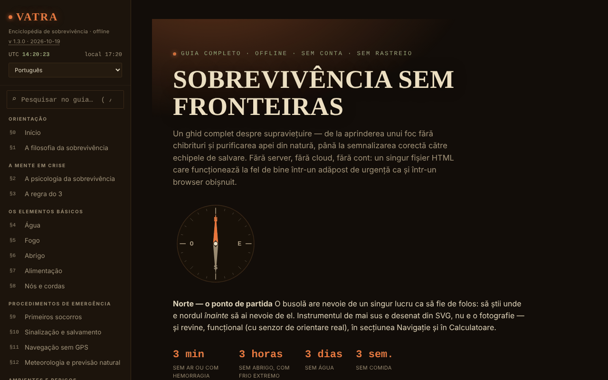

# VATRA — A enciclopédia da sobrevivência

[English](README.md) · [Română](README.ro.md) · [Français](README.fr.md) · [Italiano](README.it.md) · [Español](README.es.md) · **Português** · [Deutsch](README.de.md) · [Magyar](README.hu.md)

**Versão:** 2.1.0 · **Última atualização:** 2026-10-27

**Estado:** estável · **Offline:** completo

Idiomas da interface: **Română, English, Français, Italiano, Español, Português (PT), Deutsch, Magyar**

**Aplicação online / demo:** https://chiuta.github.io/VATRA/

Guia de sobrevivência num único ficheiro HTML (`index.html`), em 8 idiomas: ~21 secções (água, fogo, abrigo, alimentação, nós, primeiros socorros, sinalização, navegação sem GPS, meteorologia, ambientes, desastres, fauna perigosa, recursos para a Roménia), kit de emergência interativo, calculadoras (água, calorias, hipotermia/hipertermia, azimute), bússola, glossário e teste de conhecimentos.

**Idiomas:** todas as secções do guia, o glossário e o questionário de conhecimentos estão disponíveis nos 8 idiomas; os nomes próprios oficiais (Salvamont, RO-ALERT, etc.), os símbolos Morse, os números/códigos e os nomes científicos latinos permanecem inalterados. As traduções são automáticas, não verificadas por falantes nativos; **o conteúdo de primeiros socorros (RCP, hemorragia/torniquete, hipotermia, hipertermia, queimaduras, mordeduras de cobra/carraça, choque), as doses de purificação da água (iodo, cloro, SODIS), as plantas/cogumelos comestíveis e o teste de comestibilidade, bem como as regras legais e os números de emergência da Roménia (112, SMS 113, Salvamont, RO-ALERT) precisam de revisão especializada**; são traduções fiéis, sem conselhos acrescentados. A pergunta do questionário em curso só é atualizada na pergunta seguinte após uma mudança de idioma.

**Conteúdo educativo geral; não substitui um curso certificado de primeiros socorros ou de sobrevivência, a equipa de socorro local nem a avaliação médica especializada.** Numa emergência, na Roménia, ligue para o 112. As informações do guia (incluindo números, contactos, dados sobre fauna ou legislação) podem ficar desatualizadas; verifique as fontes oficiais. As calculadoras são indicativas.

## Utilização
Pesquise em todo o guia a partir do campo da barra lateral (atalho `/`).
Abra `index.html` num navegador (ou a versão publicada através do GitHub Pages); funciona offline. Tema «Noite»/«Dia» na barra lateral (a escolha é guardada). As marcações do kit, as suas próprias notas, o progresso do teste e o tema são guardados automaticamente em local no navegador (`localStorage`, chave `vatra:v1`); pode apagá-los na barra lateral («Apagar os dados guardados no navegador») ou exportá-los/importá-los como ficheiro.

## Novas funcionalidades (v1.1.0, 14 de outubro de 2026)

Sem novas funcionalidades de aprendizagem nesta versão: **a repetição espaçada já existe** (§19 Teste de conhecimentos, «Modo: Repetição espaçada», com exportação/importação do progresso) e não foi duplicada. O único acrescento é o kit abaixo.

### Transparência e cópia de segurança (fff-kit)

Um clique (ou Enter) na versão apresentada (`v 1.1.0 · 2026-10-14`) abre a janela «Transparência»: os anfitriões de rede declarados (0 pedidos externos), as chaves de armazenamento local com os tamanhos, as API utilizadas, o tamanho e o SHA-256 do ficheiro (com um verificador para um ficheiro transferido) e a **cópia de segurança** dos dados da aplicação num ficheiro `.fff.json` (opcionalmente cifrado com palavra-passe, AES-GCM 256 / PBKDF2; a palavra-passe não pode ser recuperada), a importação com confirmação e a eliminação dos dados da aplicação. O kit (`fff-kit`, módulos: core, label, bundle) está colado em `index.html`, não faz pedidos de rede e não altera os dados existentes; sem ele a aplicação funciona da mesma forma. A cópia de segurança do kit inclui a chave de armazenamento opcional da aplicação (se ativou a conservação no dispositivo), não o progresso do teste, que se exporta através de «Exportar o progresso». Os textos do kit estão em 8 línguas (ro, en, fr, it, es, pt, hu, de); **as traduções fr/it/es/pt/hu/de são automáticas e não foram verificadas por falantes nativos**. A interface e o conteúdo da aplicação também estão disponíveis nos 8 idiomas (ver a nota sobre idiomas no início); as traduções do conteúdo são automáticas, não verificadas por falantes nativos.

## Dados e privacidade
Verificado por auditoria: a página não faz pedidos de rede (0 pedidos ao carregar, sem `fetch`/CDN/tipos de letra externos) e não envia nada para lado nenhum; o único armazenamento é o `localStorage` local (chave `vatra:v1`, com as marcações do kit, as notas, o progresso do teste e o tema), tão privado quanto o próprio ficheiro. A geolocalização (o botão da calculadora de azimute) é usada apenas a pedido, localmente. As ligações externas (Salvamont, RO-ALERT, Cruz Vermelha, etc.) só se abrem ao clicar. Tem uma política CSP rigorosa (meta): sem ligações de rede (`connect-src 'none'`), script permitido apenas por hash SHA-256 (sem `unsafe-inline` para scripts), estilos inline.

## Limitações
- Fontes citadas apenas em parte (sem referências bibliográficas detalhadas); a estimativa da população de ursos tem agora fonte (AGERPRES, 10 de abril de 2025); a legislação sobre a intervenção relativa aos ursos muda com frequência (OUG 60/2025 e a lei subsequente) e não é citada artigo a artigo: consulte legislatie.just.ro.
- O teste de comestibilidade e os procedimentos de primeiros socorros são resumos gerais, não protocolos médicos.

## Licença

MIT — ver o ficheiro `LICENSE`. © 2026 Alexandru-Ionuț Chiuță (Alexio). Eventuais bibliotecas de terceiros incluídas no ficheiro mantêm as suas próprias licenças.

A ligação «Comunicar um erro» (GitHub) aponta agora para `chiuta/vatra`. As indicações médicas e de sobrevivência (incluindo o teste universal de comestibilidade, assinalado «apenas plantas, último recurso») continuam a ser conteúdo do autor, com o aviso presente na página e acima.

Auditoria: 2026-10-10

## Ficha de bolso e instalação (v2.1.0)

O botão **Imprimir a ficha de bolso** (barra lateral) imprime uma única ficha de bolso (A4, para recortar pela linha tracejada) com a regra do 3, a ordem das decisões, os sinais e o guião da chamada para o 112, no idioma escolhido; o resto do guia não é impresso. Os textos vêm do guia, por isso ficam sincronizados. **Instalação como aplicação (PWA):** o manifesto e o service worker já existiam; agora aparece o botão **Instalar como aplicação** quando o navegador o oferece; caso contrário, uma indicação de texto (só a partir da página publicada em https, não de um ficheiro local). Não se usou um manifesto «inline» (blob): exigiria relaxar `manifest-src`.

## Histórico / Changelog
- **2.1.0 — 2026-10-27:** ficha de bolso imprimível (CSS `@media print`) e botão de instalação PWA; linhas Estado/Offline; CHANGELOG.md (anterior: v2.0.0).

### 1.3.10 — 2026-10-23
- Índice de calor: segue agora o algoritmo NWS completo (primeiro a fórmula simples, a regressão de Rothfusz só quando atinge 80 °F, mais as duas correções documentadas para humidade muito baixa e muito alta); antes, os valores próximos do limiar de 27 °C e com humidade < 13 % ou > 85 % estavam ligeiramente desviados.
- Notas pessoais: no máximo 500 notas (restauro, importação e adição manual), para que um ficheiro ou cópia hostil não possa bloquear a página nem encher o armazenamento.
- Em ecrãs táteis (`pointer: coarse`) os controlos de menu, tema e idioma têm uma área tátil de 44 px.

### 1.3.9 — 2026-10-23
- fff-kit 1.2.0: a confirmação «repor a lista de verificação» usa agora o diálogo acessível comum do kit (FFF.dialog); a cópia própria do código do diálogo (incluindo a alternativa com `confirm` nativo) foi removida. Comportamento e traduções inalterados.

### 1.3.7 — 2026-10-22
- fff-kit 1.1.4: alvos táteis e texto mínimo; alvos táteis/texto corrigidos

### 1.3.6 — 2026-10-22
- Acessibilidade: o campo de pesquisa mostra agora um anel de foco claro (contraste de pelo menos 3:1) nos temas noite e dia.

### 1.3.5 — 2026-10-22
- fff-kit 1.1.2: PBKDF2 com 600.000 iterações, proteção anti-clickjacking.

### 1.3.4 — 2026-10-22
- A confirmação de reposição da lista de verificação é uma caixa de diálogo modal traduzida em vez do confirm() do navegador.
- Acessibilidade: os quatro campos de importação (cópia de segurança, lista de verificação, progresso de revisão, notas) têm nomes anunciados pelos leitores de ecrã.
- Móvel: o texto tem pelo menos 12 px e os botões e campos têm áreas táteis maiores em ecrãs estreitos.

### 1.3.3 — 2026-10-22
- na interface romena, os termos do glossário, nós e opções do quiz que estavam em inglês (sunk cost, debris hut, clove hitch, rolling hitch, bear spray, lean-to, PLB, etc.) têm agora nomes romenos com o termo inglês entre parênteses; «Home» na navegação italiana passa a «Inizio».

### 1.3.2 — 2026-10-22
- A meta descrição e a descrição do painel de transparência fff-kit seguem agora o idioma da interface (antes apenas em romeno).

### 1.3.1 — 2026-10-19
- Todo o guia, o glossário e o questionário estão traduzidos para en, fr, it, es, pt, de, hu (o ficheiro cresce para cerca de 1,5 MB); a interface já não é só em romeno. O conteúdo médico/de sobrevivência precisa de revisão especializada.

### 1.2.0 — 2026-10-19
- Novo: na calculadora «Azimute e distância», a ligação «↗ O céu neste momento, no Bolta» (posição retirada dos campos, arredondada a ~1 km; abre num novo separador; aviso sobre o histórico).

### 1.1.0 — 2026-10-14
- fff-kit: a janela «Transparência» (clique na versão) e a cópia de segurança unificada `.fff.json`. O conteúdo e a repetição espaçada não mudaram.

### 1.0.4 — 2026-10-12
- A versão e a data da última atualização são apresentadas na aplicação (barra lateral).

### 1.0.3 — 11 de outubro de 2026 (ronda 7)
- Novo: pesquisa em todo o guia (campo na barra lateral, atalho `/`; sem distinção de diacríticos, resultados com excerto e salto para a passagem encontrada).
- Corrigido: nas secções que não a Página inicial, a página não tinha nenhum título de nível 1 (axe-core `page-has-heading-one`); agora o cabeçalho «VATRA» da barra lateral passa a título de nível 1 fora da Página inicial.

### 1.0.2 — 11 de outubro de 2026 (ronda 6)
- Acrescentado: gravação local automática do kit, das notas, do progresso do teste e do tema (com botão de eliminação); CSP com `script-src` por hash.

### 1.0.1 — 11 de outubro de 2026
- Corrigido: o título do hero já não mostra carateres aleatórios durante a animação (efeito de revelação; o texto final está sempre na página).
- Corrigido: acessibilidade: o cabeçalho móvel é um `<header>`, os títulos do rodapé são h3 (ordem correta); 0 violações axe-core a 1280 e 360 px.
- Acrescentado: política CSP rigorosa; versão 1.0.1 apresentada na barra lateral.
- Atualizado: dados sobre os ursos verificados em 11.10.2026 (fonte: AGERPRES, 10.04.2025); a formulação sobre a legislação já não afirma uma alteração não verificada de maio de 2026. Fontes verificadas em 11.10.2026.

